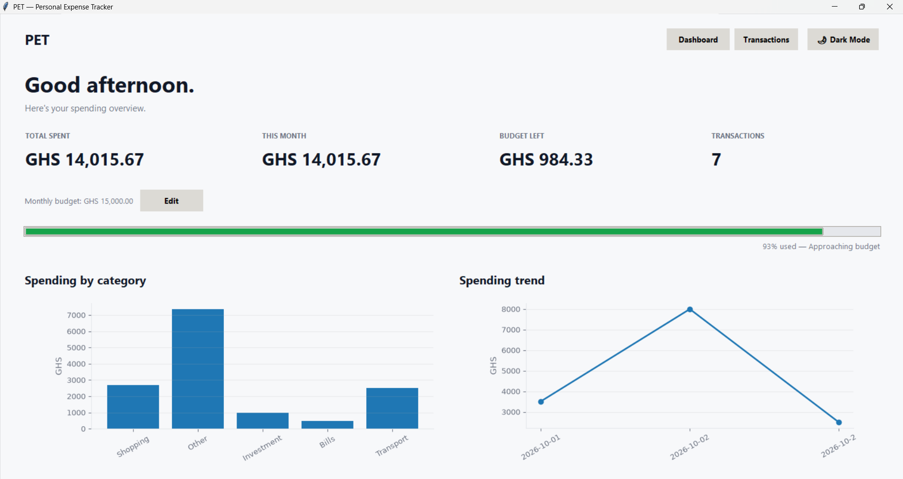
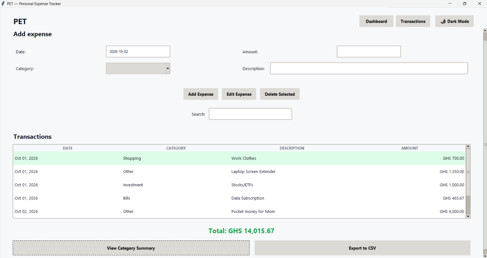
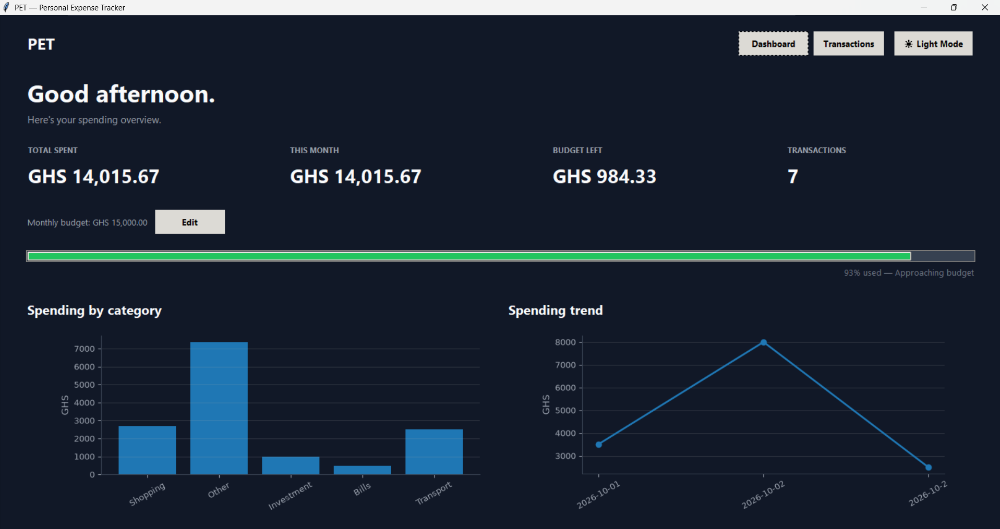
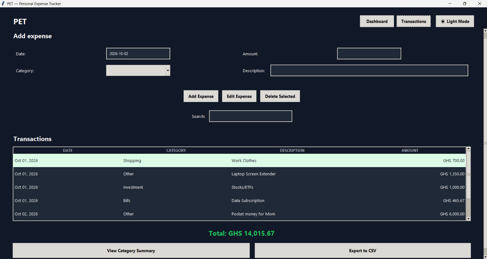

# PET — Personal Expense Tracker

A personal expense tracker built with **Python and Tkinter**.

This project was built as part of my Python learning journey, building on concepts I practiced while developing my earlier **Mad Libs** project.

PET started as a simple expense-tracking application and gradually developed into a desktop application with budgeting, data visualization, persistent storage, search, filtering, and theme customization.

## FEATURES

1. Add, edit, and delete expenses
2. Expense categories
3. Expense date tracking
4. Input and date validation
5. Monthly budget tracking
6. Dashboard spending statistics
7. Budget progress indicator
8. Category spending visualization
9. Spending trend visualization
10. Search and filtering
11. CSV export
12. Light and dark themes
13. Persistent expense data
14. Persistent user settings
15. Scrollable transaction list
16. Keyboard shortcuts

## SCREENSHOTS

### Dashboard — Light Mode



### Transactions — Light Mode



### Dashboard — Dark Mode



### Transactions — Dark Mode




## TECHNOLOGIES

1. Python
2. Tkinter
3. JSON
4. Matplotlib
5. CSV
6. File handling
7. Git and GitHub

## HOW TO RUN

### 1. Clone the repository

Open a terminal and run:

```bash
git clone https://github.com/JuKe888/PET.git
```

### 2. Navigate into the project

```bash
cd PET
```

### 3. Install the required dependency

```bash
pip install matplotlib
```

### 4. Run the application

```bash
python main.py
```

PET should now launch as a desktop application.

### Requirements

* Python 3.x
* Git
* Tkinter
* Matplotlib

Tkinter is included with most standard Python installations.

## WHAT I PRACTICED

This project was used to practice and apply:

1. Variables and data types
2. Lists and dictionaries
3. Functions and parameters
4. Conditional statements
5. Loops
6. Input validation
7. Exception handling
8. File handling
9. JSON data
10. Modules and imports
11. Tkinter widgets and layouts
12. Event-driven programming
13. GUI navigation
14. CRUD operations
15. Data persistence
16. Searching and filtering
17. Data visualization
18. Working with dates
19. Code organization
20. Refactoring
21. Git and GitHub

## PROJECT STRUCTURE

```text
PET/
│
├── main.py                  # Main application and GUI
├── expense_manager.py       # Expense logic and data handling
├── README.md                # Project documentation
└── .gitignore               # Git ignore rules
```

The following files are created locally while the application is running and are intentionally excluded from Git:

```text
expenses.json
settings.json
expenses_export.csv
```

## PROJECT JOURNEY

PET is the second major Python project in my current learning journey.

My earlier **Mad Libs** project focused on Python fundamentals and introduced me to building a Tkinter GUI.

PET builds on those concepts by working with a larger application and introducing persistent data, multiple screens, budgeting, CRUD operations, and data visualization.

The project is intentionally being developed incrementally as I continue learning Python.

## FUTURE IMPROVEMENTS

Possible future improvements include:

1. Recurring expenses
2. Planned expenses
3. Income tracking
4. Category-specific budgets
5. More detailed financial analytics
6. Improved data management
7. Database storage
8. Automated backups
9. Additional customization
10. Financial goals and savings tracking

## AUTHOR

Built as part of my **Python learning journey**.
